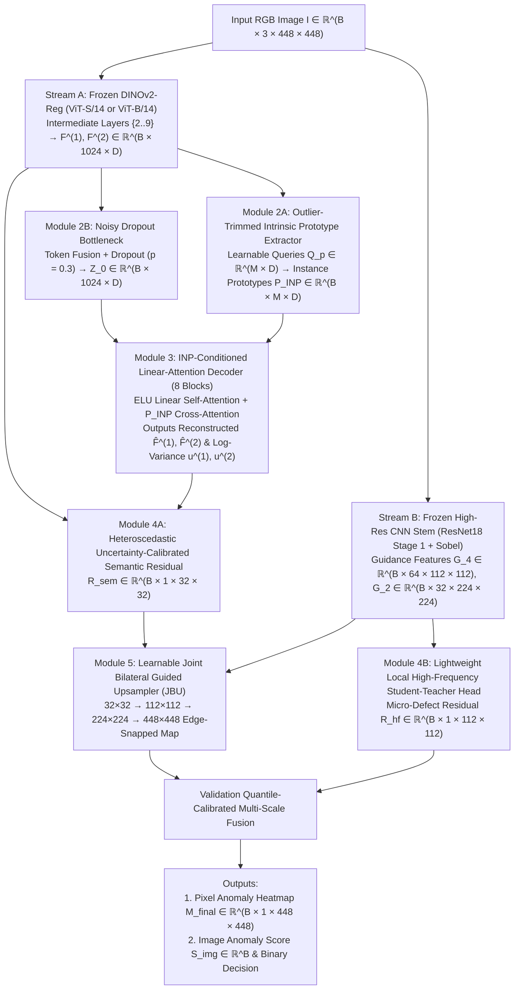

# Technical Architecture & Research Specification: HiRes-ProtoAD

**Project:** SmartLens — Visual Defect Detection Using Deep Learning and Calibrated Multi-Scale Anomaly Scoring  
**Module:** NUS-ISS Pattern Recognition Systems Practice Module (Group 30)  
**Team Members:** Yeom Dongjun (A0354802H), Zaiyu Zhang (A0357851U), Worameth Wittanakorn (A0356365W), Nguyen Tri Nghia (A0355672W)  
**Proposed Architecture:** **HiRes-ProtoAD** (*Intrinsic-Prototype-Conditioned Foundation Reconstruction with Guided High-Resolution Upsampling and Spatial Uncertainty Calibration*)  
**Document Version:** 1.0 (October 2026)

> **Implementation audit (30 October 2026):** This document describes the proposed
> HiRes-ProtoAD architecture. Only the three reference baselines and evaluation pipeline
> are implemented; A1–A4 are not. The old independent-model ensemble and EfficientAD have
> been removed. The experiment plan uses one fixed seed (42) per baseline/ablation.
> Latency, parameter-count and accuracy statements about HiRes-ProtoAD below are design
> targets/hypotheses, not measured results. The existing MVTec results are bottle-only
> 300-iteration smoke tests. See [IMPLEMENTATION_AUDIT.md](IMPLEMENTATION_AUDIT.md) for
> measured limitations and the current experiment requirements. Full training will move
> to the user-selected 24GB+ GPU; that target has not yet been provisioned or profiled.

---

## 1. Executive Summary & Alignment with Project Proposal

Manufacturers require automated, consistent visual inspection capable of flagging rare, unpredictable physical defects while training **exclusively on normal (defect-free) product images**. 

In our initial proposal (`Visual_Defect_Detection_Project_Proposal.docx`), we outlined a prototype combining unsupervised learning, deep reconstruction, pretrained feature representations, and ensemble anomaly scoring, evaluated via detection accuracy, false alarm rates, localization quality, and inference speed.

A critical review of 2020–2026 Industrial Anomaly Detection (IAD) literature reveals that naively ensembling a pixel-level Convolutional Autoencoder (~80% AUROC) with a pretrained CNN memory bank (~99% AUROC) suffers from **weak-member drag**: blurry pixel-space residuals introduce severe edge false alarms that degrade overall accuracy. Meanwhile, the newest 2025 State-of-the-Art (SOTA) unified foundation models—such as **Dinomaly (CVPR 2025)** and **INP-Former (CVPR 2025)**—achieve >99.5% Image AUROC on standard MVTec AD, yet still break down on three real-world challenges exposed by **VisA** and the **CVPR 2025 VAND 3.0 Challenge (MVTec AD 2)**:
1. **Coarse $14 \times 14$ ViT Patch Quantization:** Vision Transformers (`DINOv2`) compress $14 \times 14$ pixel patches into single tokens, blurring anomaly boundaries and missing 1–3 pixel micro-defects (hairline cracks, PCB shorts, pinholes) unless slow multi-crop tiling is used.
2. **Illumination & Pose Shift Sensitivity:** Static feature decoders memorize training-set lighting; test-time brightness or alignment shifts elevate reconstruction residuals globally across normal surfaces.
3. **Homoscedastic False Alarms on Reflective/Edge Regions:** Standard cosine or $L_2$ scoring weights every pixel equally, causing specular glare, metallic bevels, and object boundaries with high natural variance to trigger false alarms.

### Proposed Solution: HiRes-ProtoAD
**HiRes-ProtoAD** is a unified, single-pass, multi-class unsupervised anomaly detection architecture that directly resolves these three bottlenecks while fulfilling every requirement of the project proposal:
1. **Semantic Foundation Stream + Local High-Frequency CNN Stream:** Combines frozen **DINOv2-Register** contextual representations ($H/14 \times W/14$) with a lightweight **High-Resolution CNN Guidance Stem** ($H/4 \times W/4$) for micro-defect sensitivity.
2. **Test-Time Intrinsic Normal Prototype (INP) Conditioning:** Extracts outlier-trimmed normal prototypes dynamically from the test image itself to adapt the Linear-Attention feature reconstruction decoder to instance-specific lighting and pose.
3. **Heteroscedastic Spatial Uncertainty Calibration:** Predicts normal feature reconstruction variance $\sigma^2(x,y)$ via Negative Log-Likelihood (NLL) training, mathematically suppressing false alarms on reflective edges and complex geometries.
4. **Learnable Joint Bilateral Guided Upsampling (JBU):** Replaces blurry bilinear interpolation and slow 16-crop tiling with an edge-aware bilateral upsampler guided by high-resolution CNN features, snapping anomaly heatmaps to exact pixel boundaries in **~18–25 ms** per image.

---

## 2. Literature Positioning & Bottleneck Mapping

| Method | Venue | Core Paradigm | Multi-Class Unified? | Micro-Defect Boundary Sharpness | Lighting / Glare Robustness | Inference Latency |
| :--- | :--- | :--- | :---: | :---: | :---: | :---: |
| **SSIM-CAE** | Baseline | Pixel Autoencoder | No | Poor (blurry edges) | Low | ~5 ms |
| **PatchCore** | CVPR 2022 | Pretrained CNN + Coreset k-NN | Poor (VRAM scales) | Moderate ($H/8$) | Moderate | ~30–45 ms |
| **EfficientAD** | WACV 2024 | PDN Student-Teacher + Feature AE | No (1 model/class) | Moderate-Good | Low-Moderate | **~2 ms** |
| **Dinomaly** | CVPR 2025 | DINOv2-R + Dropout + Linear Attn | **Yes** | Coarse ($H/14$ grid) | Moderate | ~15 ms |
| **INP-Former** | CVPR 2025 | DINOv2-R + Intrinsic Prototypes | **Yes** | Coarse ($H/14$ grid) | Moderate-High | ~18 ms |
| **VAND 2025 Winners** | CVPRW 2025 | High-Res Tiling + Heuristic Post-Proc | Partial | High (via tiling) | Moderate (heavy aug) | Slow (200–500 ms) |
| **HiRes-ProtoAD (Ours)** | **Proposed** | **INP-Conditioned DINOv2 + JBU + Uncertainty + Local HF** | **Yes** | **High ($H/4 \to H$ Guided)** | **High (INP + $\sigma^2$ NLL)** | **~20–25 ms** |

---

## 3. System Architecture & Mathematical Formulation

### 3.1 End-to-End Dataflow Diagram



---

### 3.2 Input Preprocessing & Tensor Conventions
* **Input Resolution:** $H \times W = 448 \times 448$ (divisible by both $14$ for ViT/14 giving $32 \times 32 = 1024$ spatial tokens, and $4$ for the CNN stem giving $112 \times 112$). For faster prototyping on constrained GPUs, $392 \times 392$ ($28 \times 28 = 784$ tokens) is supported via config.
* **Normalization:** Standard ImageNet channel mean $\mu = [0.485, 0.456, 0.406]$ and standard deviation $\sigma = [0.229, 0.224, 0.225]$.

---

### 3.3 Module 1: Dual-Stream Feature Extraction

#### Stream A — Frozen Foundation Semantic Encoder (`DINOv2-Register`)
We use a frozen pretrained **DINOv2 with Registers** backbone (`dinov2_vits14_reg` with $D=384$ for lightweight mode, or `dinov2_vitb14_reg` with $D=768$ for high-accuracy mode). Register tokens absorb background/global artifacts that otherwise corrupt spatial patch norm distributions in plain ViTs.

1. Given input $I \in \mathbb{R}^{B \times 3 \times H \times W}$, extract patch token sequences (discarding `[CLS]` and 4 `[REG]` tokens) from intermediate Transformer blocks $l \in \{2, 3, 4, 5, 6, 7, 8, 9\}$ (1-indexed out of 12 blocks; avoiding overly raw block 1 and overly semantic/spatial-agnostic blocks 11–12).
2. Following loose hierarchical grouping, aggregate these 8 layers into two target feature scales via layer-normalized averaging:
   $$F^{(1)} = \frac{1}{4}\sum_{l=2}^{5} \text{LN}(H_l) \in \mathbb{R}^{B \times N \times D}, \qquad F^{(2)} = \frac{1}{4}\sum_{l=6}^{9} \text{LN}(H_l) \in \mathbb{R}^{B \times N \times D}$$
   where $N = \frac{H}{14}\cdot\frac{W}{14} = 1024$.

#### Stream B — Frozen High-Resolution CNN Guidance Stem
To recover spatial details lost inside $14 \times 14$ patches, we extract high-resolution local appearance and edge representations from a frozen `ResNet-18` early stem (`conv1` $\to$ `bn1` $\to$ `relu` at stride 2, followed by `maxpool` $\to$ `layer1` at stride 4), concatenated with parameter-free Sobel horizontal/vertical gradient magnitudes $\|\nabla_x I\|, \|\nabla_y I\|$:
* **Stride-2 Guidance Map:** $G_2 \in \mathbb{R}^{B \times 32 \times (H/2) \times (W/2)}$ (projected from `conv1` + image gradients via a $1\times 1$ adapter).
* **Stride-4 Guidance & Local Feature Map:** $T_4 \in \mathbb{R}^{B \times 64 \times (H/4) \times (W/4)}$ (frozen `layer1` output).

---

### 3.4 Module 2: Outlier-Trimmed Intrinsic Normal Prototype (INP) Extractor & Noisy Bottleneck

#### 2A. Outlier-Trimmed Intrinsic Normal Prototypes
In test images containing defects, 85%–99% of spatial tokens are still normal and carry vital instance-specific cues (exact ambient lighting, exposure, color temperature, and object orientation). However, standard cross-attention over all tokens risks absorbing anomalous tokens into the prototypes.

Let $F_{\text{agg}} = \frac{1}{2}(F^{(1)} + F^{(2)}) \in \mathbb{R}^{B \times N \times D}$ denote the aggregated encoder tokens, and let $Q_p \in \mathbb{R}^{M \times D}$ ($M = 8$ learnable prototype queries) represent canonical part/surface slots.
1. Compute token-to-prototype affinity logits:
   $$A = \frac{(Q_p W_Q)(F_{\text{agg}} W_K)^\top}{\sqrt{D}} \in \mathbb{R}^{B \times M \times N}$$
2. **Outlier Token Suppression Mask:** For each token $n \in \{1, \dots, N\}$, compute its maximum prototype affinity $a_{\max}(n) = \max_{m} A_{b,m,n}$. Tokens whose best prototype match falls in the bottom $\rho = 10\%$ quantile across the image (likely anomalous or severe glare outliers) receive an attention mask $m_{\text{trim}}(n) = -\infty$ (softened via straight-through Gumbel/top-$k$ masking during training; hard quantile masking at inference):
   $$W_{\text{attn}} = \text{softmax}_{N}\left(A + m_{\text{trim}}\right) \in \mathbb{R}^{B \times M \times N}$$
3. **Extracted Intrinsic Normal Prototypes:**
   $$P_{\text{INP}} = \text{LN}\left(W_{\text{attn}} (F_{\text{agg}} W_V) + Q_p\right) \in \mathbb{R}^{B \times M \times D}$$

#### 2B. Noisy Bottleneck Embedding
To prevent the decoder from learning an "identity shortcut" (copying anomalous input tokens directly to the output), `F_agg` passes through a noisy MLP bottleneck with high feature-wise and token-wise Dropout ($p = 0.3$ during training, disabled at inference):
$$Z^{(0)} = \text{MLP}_{\text{bot}}\left(\text{Dropout}_{0.3}(F_{\text{agg}})\right) \in \mathbb{R}^{B \times N \times D}$$

---

### 3.5 Module 3: INP-Conditioned Linear-Attention Decoder

We stack $K = 8$ lightweight Transformer decoder blocks. Each block $k \in \{1, \dots, 8\}$ comprises three operations:

1. **Low-Pass Linear Self-Attention:**
   Standard softmax attention ($O(N^2 D)$) focuses sharply on individual anomalous tokens and reconstructs them too faithfully. Replacing softmax with **ELU Kernel Linear Attention** ($O(N D^2)$) using feature map $\phi(x) = \text{ELU}(x) + 1$ acts mathematically as a rank-bounded low-pass filter over token space:
   $$\tilde{Z}^{(k)} = Z^{(k-1)} + \text{Proj}\left(\frac{\phi(Q_{\text{self}})\left(\phi(K_{\text{self}})^\top V_{\text{self}}\right)}{\phi(Q_{\text{self}})\left(\phi(K_{\text{self}})^\top \mathbf{1}_N\right) + \epsilon}\right)$$
2. **INP Cross-Attention Conditioning (Instance Lighting/Pose Adaptation):**
   Tokens attend to the $M = 8$ clean Intrinsic Normal Prototypes $P_{\text{INP}}$ ($O(N M D)$ cost, negligible since $M=8 \ll N=1024$):
   $$\hat{Z}^{(k)} = \tilde{Z}^{(k)} + \text{CrossAttn}\left(Q = \text{LN}(\tilde{Z}^{(k)}),\; K = P_{\text{INP}},\; V = P_{\text{INP}}\right)$$
3. **Feed-Forward Network (FFN):**
   $$Z^{(k)} = \hat{Z}^{(k)} + \text{FFN}(\text{LN}(\hat{Z}^{(k)}))$$

**Hierarchical Feature Reconstruction Heads:**
* Intermediate decoder states $\{Z^{(1)}, \dots, Z^{(4)}\}$ and $\{Z^{(5)}, \dots, Z^{(8)}\}$ are fused to predict the reconstructed encoder feature groups:
  $$\hat{F}^{(1)} = \text{Proj}_1\left(\frac{1}{4}\sum_{k=1}^{4} Z^{(k)}\right), \qquad \hat{F}^{(2)} = \text{Proj}_2\left(\frac{1}{4}\sum_{k=5}^{8} Z^{(k)}\right)$$

---

### 3.6 Module 4: Heteroscedastic Uncertainty Head & Local High-Frequency Branch

#### 4A. Heteroscedastic Spatial Uncertainty Head (False-Alarm Suppression)
Normal industrial parts contain regions with inherently higher feature variance (e.g., brushed metal grain, screw threads, specular curved edges, slight part positioning tolerances). A small 2-layer $1\times 1$ Conv/MLP head predicts spatial log-variance $u^{(s)} \in \mathbb{R}^{B \times N \times 1}$ for each group $s \in \{1, 2\}$ from the clean prototype-aligned decoder state (detached from input anomalies via $P_{\text{INP}}$-conditioned features), bounded smoothly via:
$$u^{(s)} = u_{\max} \cdot \tanh\left(\frac{\text{MLP}_{\sigma}(Z^{(4s)})}{u_{\max}}\right), \qquad u_{\max} = 2.5$$
For every token position $n$, let the raw cosine distance be $d^{(s)}(n) = 1 - \frac{\langle F^{(s)}(n), \hat{F}^{(s)}(n) \rangle}{\|F^{(s)}(n)\|_2 \|\hat{F}^{(s)}(n)\|_2 + \epsilon}$. The **uncertainty-calibrated semantic residual** reshaped to spatial grid $\frac{H}{14} \times \frac{W}{14}$ ($32 \times 32$) is:
$$R_{\text{sem}}(x,y) = \frac{1}{2} \sum_{s=1}^{2} \exp\left(-u^{(s)}(x,y)\right) \cdot d^{(s)}(x,y)$$

#### 4B. Local High-Frequency Student-Teacher Residual ($H/4 \times W/4$)
To detect hairline defects (width $< 3$ pixels) whose signal averages out inside a $14 \times 14$ ViT patch, a compact 3-layer depthwise-separable Student CNN $S_{\text{hf}}(I)$ predicts the frozen `ResNet-18` `layer1` feature map $T_4 \in \mathbb{R}^{B \times 64 \times 112 \times 112}$ (channel-standardized using normal training mean/std), accompanied by local log-variance $u_{\text{hf}} \in \mathbb{R}^{B \times 1 \times 112 \times 112}$:
$$R_{\text{hf}}(x', y') = \exp(-u_{\text{hf}}(x',y')) \cdot \frac{1}{64}\left\| \bar{T}_4(x',y') - S_{\text{hf}}(I)(x',y') \right\|_2^2$$

---

### 3.7 Module 5: Learnable Joint Bilateral Guided Upsampler (JBU)

Instead of bilinear interpolation—which blurs $32 \times 32$ token scores across object boundaries—we introduce a cascade of two **Learnable Joint Bilateral Upsampling (JBU)** stages (`FeatUp`-inspired, applied directly to multi-channel decoder residual embeddings before collapsing to scalar maps, or directly to hierarchical residual maps):
* **Stage 1:** $32 \times 32 \xrightarrow{\text{guided by } G_4} 112 \times 112$
* **Stage 2:** $112 \times 112 \xrightarrow{\text{guided by } G_2, I} 448 \times 448$

For target high-res pixel $p = (i, j)$ and source low-res neighborhood $\mathcal{N}(p)$ ($K_s \times K_s = 5 \times 5$ window around projected coordinate $\tilde{p}$), the bilateral kernel weight $w(p, q)$ combines spatial proximity and guidance feature similarity:
$$w(p, q) = \frac{1}{Z_p} \exp\left( -\frac{\|\tilde{p} - q\|_2^2}{2\sigma_{\text{spatial}}^2} - \frac{\|\psi(G(p)) - \psi(G_{\downarrow}(q))\|_2^2}{2\sigma_{\text{range}}^2} \right)$$
where $\psi(\cdot)$ is a lightweight $1\times 1$ Conv-Norm-SiLU projection ($32$ dims), $\sigma_{\text{spatial}}, \sigma_{\text{range}} > 0$ are learnable temperature parameters, and $Z_p = \sum_{q \in \mathcal{N}(p)} w(p,q)$.

* **Why JBU Eliminates Boundary Halos:** If a defect sits right next to an object edge, or if a coarse patch straddles the object boundary, $w(p,q)$ assigns near-zero weight across strong color/gradient discontinuities in $G(p)$, snapping the upsampled anomaly region strictly to the true physical defect contour.

---

## 4. Training Objectives & Calibrated Inference Scoring

All training uses **100% normal (defect-free) images**—strictly preserving unsupervised integrity.

### 4.1 Multi-Term Unsupervised Loss Function

$$\mathcal{L}_{\text{total}} = \mathcal{L}_{\text{sem-NLL}} + \lambda_{\text{hm}} \mathcal{L}_{\text{hard}} + \lambda_{\text{hf}} \mathcal{L}_{\text{hf-NLL}} + \lambda_{\text{jbu}} \mathcal{L}_{\text{jbu}} + \lambda_{\text{reg}} \left(\mathcal{L}_{\text{proto}} + \mathcal{L}_{\text{tv}}\right)$$

1. **Heteroscedastic Semantic Cosine NLL Loss ($\mathcal{L}_{\text{sem-NLL}}$):**
   $$\mathcal{L}_{\text{sem-NLL}} = \frac{1}{2BN} \sum_{b=1}^{B} \sum_{s=1}^{2} \sum_{n=1}^{N} \left[ \exp\left(-u_{b,n}^{(s)}\right) d_{b,n}^{(s)} + \alpha_u u_{b,n}^{(s)} \right], \qquad \alpha_u = 0.5$$
2. **Hard-Mining Cosine Loss ($\mathcal{L}_{\text{hard}}$, following `Dinomaly`):**
   Focuses gradient updates on complex normal structures rather than easy flat background tokens by down-weighting tokens whose reconstruction distance is already below the batch median (or top-$10\%$ hardest normal tokens):
   $$\mathcal{L}_{\text{hard}} = \frac{1}{2B |\Omega_{\text{hard}}|} \sum_{s=1}^{2} \sum_{(b,n) \in \Omega_{\text{hard}}} d_{b,n}^{(s)}$$
3. **Local High-Frequency Student-Teacher NLL Loss ($\mathcal{L}_{\text{hf-NLL}}$):**
   $$\mathcal{L}_{\text{hf-NLL}} = \frac{1}{B H_4 W_4} \sum_{b, x', y'} \left[ \exp(-u_{\text{hf}}) \frac{1}{64}\|\bar{T}_4 - S_{\text{hf}}(I)\|_2^2 + \alpha_u u_{\text{hf}} \right]$$
4. **Self-Supervised JBU Multi-Scale Consistency Loss ($\mathcal{L}_{\text{jbu}}$):**
   Trains the JBU kernel parameters $\psi, \sigma_{\text{spatial}}, \sigma_{\text{range}}$ without pixel defect labels via **feature downsampling-upsampling cycle consistency** on normal guidance/semantic features: downsampling $T_4$ to $32 \times 32$ via average pooling and upsampling back to $112 \times 112$ via $\text{JBU}(\cdot, G_4)$ must reconstruct $T_4$:
   $$\mathcal{L}_{\text{jbu}} = \left\| T_4 - \text{JBU}_{32 \to 112}\left(\text{AvgPool}_{112 \to 32}(T_4),\; G_4\right) \right\|_1$$
5. **Regularization ($\mathcal{L}_{\text{proto}} + \mathcal{L}_{\text{tv}}$):**
   * *Prototype Diversity:* $\mathcal{L}_{\text{proto}} = \left\| \hat{Q}_p \hat{Q}_p^\top - I_M \right\|_F^2$ (where rows of $\hat{Q}_p$ are $L_2$-normalized prototype queries) prevents prototype slot collapse.
   * *Uncertainty Spatial Smoothness:* Total variation $\mathcal{L}_{\text{tv}}(u) = \|\nabla_x u\|_1 + \|\nabla_y u\|_1$ ensures $\sigma^2(x,y)$ models smooth structural uncertainty zones rather than pixel noise.

**Default Loss Weights:** $\lambda_{\text{hm}} = 0.5$, $\lambda_{\text{hf}} = 0.5$, $\lambda_{\text{jbu}} = 0.2$, $\lambda_{\text{reg}} = 0.05$.

---

### 4.2 Validation-Calibrated Fusion & Inference Scoring

To combine the upsampled semantic map $R_{\text{sem}}^{\uparrow 448}$ and upsampled local high-frequency map $R_{\text{hf}}^{\uparrow 448}$ without scale mismatch (adapting `EfficientAD` quantile calibration, computed strictly on the **Normal Validation Split** $\mathcal{D}_{\text{val}}^{\text{norm}}$):

1. Compute the $q_{0.90}$ and $q_{0.995}$ pixel anomaly quantiles across all pixels of images in $\mathcal{D}_{\text{val}}^{\text{norm}}$ for each branch $m \in \{\text{sem}, \text{hf}\}$:
   $$\tilde{R}_m(x,y) = 0.1 \cdot \frac{R_m^{\uparrow}(x,y) - q_{0.90}^{(m)}}{q_{0.995}^{(m)} - q_{0.90}^{(m)} + \epsilon}$$
   *(Thus on normal validation images, 90% of pixels map to $\le 0$ and 99.5% map to $\le 0.1$, placing both branches on an identical false-alarm probability scale.)*
2. **Fused Pixel-Level Anomaly Map:**
   $$\mathcal{M}_{\text{final}}(x,y) = \text{GaussianSmooth}_{\sigma=2.0}\left( \beta \tilde{R}_{\text{sem}}(x,y) + (1 - \beta) \tilde{R}_{\text{hf}}(x,y) \right), \qquad \beta = 0.7$$
   *(Note: $\sigma = 2.0$ preserves sharp JBU boundaries, compared to standard SOTA which requires heavy $\sigma = 4.0\text{–}8.0$ smoothing.)*
3. **Image-Level Anomaly Score ($S_{\text{img}}$):**
   Instead of single-pixel `max` (sensitive to 1-pixel sensor spikes), compute the mean of the **top $0.1\%$ highest-scoring pixels** (approx. top 200 pixels at $448 \times 448$):
   $$S_{\text{img}} = \frac{1}{|K_{\text{top}}|} \sum_{(x,y) \in K_{\text{top}}} \mathcal{M}_{\text{final}}(x,y)$$
4. **Decision Threshold ($\tau^*$):**
   * *Purely Unsupervised Setting:* Set $\tau^*$ to the $99\text{th}$ percentile (or $\mu + 3\sigma$) of $S_{\text{img}}$ on $\mathcal{D}_{\text{val}}^{\text{norm}}$ (guarantees $\approx 1\%$ expected false alarm rate without touching any defect labels).
   * *Validation-Tuned Setting:* Select $\tau^*$ maximizing $F_1$-score on the held-out stratified validation set $\mathcal{D}_{\text{val}}$, evaluated strictly on the locked unseen test set $\mathcal{D}_{\text{test}}$.

---

## 5. Dataset Selection & Leakage-Free Evaluation Protocol

### 5.1 Selected Benchmarks

**Execution requirement:** Clean MVTec image AUROC is a reference metric, not the primary
evidence of improvement. Run every selected category, the six-category VisA micro-defect
suite, and all five OptShift conditions with fixed clean-validation thresholds. Report
pixel AP, AU-PRO at 5% and 30% FPR, and operational recall/FPR prominently. Keep smoke
tests explicitly labeled. Use `configs/visa_all.yaml` for the full 12-class VisA comparison.
Actual MVTec AD 2 remains an external benchmark to integrate; synthetic OptShift is not
a substitute for its dataset or official evaluation.

1. **Primary Benchmark — MVTec AD (15 Categories, 5,354 Images):**
   * **10 Object Categories:** `bottle`, `cable`, `capsule`, `hazelnut`, `metal_nut`, `pill`, `screw`, `toothbrush`, `transistor`, `zipper`.
   * **5 Texture Categories:** `carpet`, `grid`, `leather`, `tile`, `wood`.
   * Evaluated under **Unified Multi-Class Training** (1 model trained jointly on all 15 normal training sets, zero class label needed at test time) as well as category-level breakdown.
2. **Secondary Micro-Defect Benchmark — VisA Subset (4–6 Categories, ~4,500 Images):**
   * Focuses on tiny multi-instance and fine-grained PCB anomalies where $14 \times 14$ ViT grids struggle: `pcb1`, `pcb2`, `pcb3`, `pcb4`, `capsules`, `candle`.
3. **Optical & Illumination Shift Stress-Test (`MVTec-OptShift`):**
   * Evaluates zero-shot test-time robustness (inspired by **MVTec AD 2**) by applying controlled unseen test-time perturbations to the MVTec AD test split:
     * *Directional Illumination Gradient* ($\pm 30\%$ linear brightness ramp across image),
     * *Gamma / Exposure Shift* ($\gamma \in \{0.65, 1.45\}$),
     * *Synthetic Specular Highlight Glare* (localized Gaussian intensity bloom on normal surfaces),
     * *Mild Affine Misalignment* ($\pm 3^\circ$ rotation, $\pm 4\text{ px}$ translation).

### 5.2 Strict Train / Validation / Test Split Protocol
To satisfy the proposal requirement (*"Training, validation and testing data will be kept separate"*):
* **Training Set ($\mathcal{D}_{\text{train}}$):** $85\%$ of official `train/good` normal images per category.
* **Normal Validation Set ($\mathcal{D}_{\text{val}}^{\text{norm}}$):** Remaining $15\%$ of official `train/good` normal images (used for quantile normalization $q_{0.90}, q_{0.995}$, early stopping, and unsupervised FPR threshold $\tau_{\text{unsup}}^*$).
* **Stratified Validation / Unseen Test Split (for Precision/Recall/F1 reporting):** Stratified $20\% / 80\%$ split of official `test/` (preserving defect sub-type proportions) with fixed random seed (`seed=42`) saved to JSON split manifests under `configs/splits/` so all models are compared on identical unseen images.

---

## 6. Evaluation Metrics, Baselines & Ablation Study Plan

### 6.1 Quantitative Metrics
| Level | Metric | Purpose |
| :--- | :--- | :--- |
| **Image-Level** | **I-AUROC** (%) | Threshold-independent anomaly detection quality |
| | **I-AP** & **$F_1$-max** (%) | Performance under class imbalance |
| | **Precision, Recall, FPR@95%TPR** (%) | Directly quantifies **missed defects** vs. **false alarms** (Proposal core metric) |
| **Pixel-Level** | **AU-PRO** (up to 30% FPR, %) | Primary SOTA localization metric; weights small and large defects equally |
| | **Pixel-AP** & **Pixel-$F_1$-max** (%) | Sensitive to boundary sharpness and false-positive halos (unlike Pixel-AUROC) |
| | **P-AUROC** (%) | Standard literature comparison metric |
| **System** | **Latency (ms/image)** & **FPS** | Measured with CUDA events (`batch_size=1`, warm-up 50 iters, 200 timed iters) |
| | **Peak GPU VRAM (MB)** & **Params (M)** | Deployment footprint assessment |

### 6.2 Comparative Baselines
1. **`SSIM-CAE`:** Multi-scale convolutional autoencoder trained with $L_1 + \text{SSIM}$ loss; historical pixel-reconstruction baseline.
2. **`PatchCore`:** Pretrained CNN memory-bank reference baseline.
3. **`Dinomaly-Repro` (CVPR 2025):** Frozen `DINOv2-Reg` + Noisy Bottleneck + Linear Attention Decoder with standard bilinear upsampling and uncalibrated cosine distance.

Train each baseline and A0–A4 variant once with **seed 42**, on the same fixed manifests.

**Current-SOTA comparison requirement (October 2026):** The above baseline set is not a
verified current-SOTA leaderboard. Add and validate official INP-Former and Dinomaly2
comparators before claiming a contemporary SOTA gain. Dinomaly2's official repository
released preview code in May 2026 and notes possible paper/config discrepancies; pin
its revision and reconcile the protocol. The local Dinomaly is an adapted A0, not an
exact reproduction of the upstream crop, initialization, split and mask conventions.

### 6.3 Planned Ablation Study Matrix (Validating Every Novel Component)
| Exp ID | Model Variant | INP Cond. | Uncertainty $\sigma^2$ | Upsampler | Local HF ($H/4$) | Expected Key Gain |
| :---: | :--- | :---: | :---: | :---: | :---: | :--- |
| **A0** | Vanilla `Dinomaly` Baseline | — | — | Bilinear | — | Strong I-AUROC; blurry boundaries & glare FPs |
| **A1** | + Intrinsic Normal Prototypes | ✓ | — | Bilinear | — | Higher robustness on `MVTec-OptShift` lighting/pose |
| **A2** | + Heteroscedastic Uncertainty | ✓ | ✓ | Bilinear | — | Lower **FPR@95%TPR** on shiny metal/transistor/bottle |
| **A3** | + Learnable JBU Upsampling | ✓ | ✓ | **JBU** | — | Jump in **AU-PRO** & **Pixel-AP**; sharp defect contours |
| **A4** | **Full `HiRes-ProtoAD`** | ✓ | ✓ | **JBU** | ✓ | Best micro-defect recall (`screw`, `capsule`, `VisA PCB`) |

---

## 7. Implementation Blueprint, Hyperparameters & Repository Layout

### 7.1 Training Configuration & Compute Budget
* **Framework:** Python 3.11+, PyTorch 2.4+, `timm` (for `vit_small_patch14_reg4_dinov2` / `vit_base_patch14_reg4_dinov2` and `resnet18`), `torchmetrics`, `scikit-learn`, `opencv-python`, `gradio`.
* **Optimizer:** `AdamW` ($\text{lr} = 2 \times 10^{-4}$ for Decoder/INP/Uncertainty/HF-Student, $\text{lr} = 5 \times 10^{-4}$ for JBU, $\text{weight\_decay} = 10^{-4}$). Frozen backbones (`DINOv2`, `ResNet-18` stem) require **zero gradients**, slashing VRAM usage by >65%.
* **Schedule:** Cosine Annealing LR with 500-iteration linear warm-up; **10,000 iterations** total for unified 15-class MVTec AD ($\approx$ 45–60 mins on a single RTX 3090/4090 or A10G using `bfloat16`/`fp16` Automatic Mixed Precision, batch size 16).
* **Trainable Parameters:** ~14M (`ViT-S/14` mode) or ~38M (`ViT-B/14` mode).

### 7.2 Proposed Repository Directory Structure
```text
SmartLens/
├── Visual_Defect_Detection_Project_Proposal.docx
├── TECHNICAL_SPECIFICATION.md          # This specification document
├── pyproject.toml / requirements.txt
├── configs/
│   ├── mvtec_unified.yaml              # Unified 15-class MVTec AD config
│   ├── visa_pcb.yaml                   # VisA micro-defect config
│   └── splits/                         # Deterministic train/val/test JSON manifests
├── smartlens/
│   ├── data/
│   │   ├── datasets.py                 # MVTec AD & VisA loaders with leakage-free splits
│   │   └── perturbations.py            # MVTec-OptShift lighting/glare/affine stress tests
│   ├── models/
│   │   ├── backbones/
│   │   │   ├── dinov2_extractor.py     # Frozen DINOv2-Reg multi-layer extractor
│   │   │   └── highres_stem.py         # ResNet18 Stage-1 + Sobel guidance stem
│   │   ├── modules/
│   │   │   ├── inp_extractor.py        # Outlier-trimmed Intrinsic Normal Prototypes
│   │   │   ├── linear_decoder.py       # ELU Linear-Attention + INP Cross-Attn blocks
│   │   │   ├── uncertainty_head.py     # Heteroscedastic spatial log-variance + Local HF student
│   │   │   └── jbu_upsampler.py        # Learnable Joint Bilateral Guided Upsampler
│   │   ├── hires_protoad.py            # Full HiRes-ProtoAD model assembly
│   │   └── baselines/
│   │       ├── ssim_cae.py             # Baseline 1: Convolutional SSIM Autoencoder
│   │       └── patchcore.py            # Baseline 2: Pretrained CNN Memory Bank
│   ├── losses/
│   │   └── protoad_loss.py             # NLL + Hard-Mining Cosine + JBU Consistency + Reg
│   ├── evaluation/
│   │   ├── calibration.py              # Validation quantile normalization & threshold tuning
│   │   ├── metrics.py                  # I-AUROC, P-AUROC, AU-PRO, Pixel-AP, FPR@95, Latency
│   │   └── error_analysis.py           # Automated false-alarm & missed-defect gallery export
│   └── utils/
│       └── visualization.py            # Side-by-side RGB, Uncertainty map, Overlay & Mask plots
├── scripts/
│   ├── prepare_splits.py               # Generates train/val/test manifests
│   ├── train.py                        # Unified & ablation training entrypoint
│   ├── evaluate.py                     # Full benchmark + OptShift + latency profiler
│   └── run_ablations.py                # Automated A0–A4 ablation runner
└── app/
    └── demo_gradio.py                  # Interactive Web UI (Upload → Score, Heatmap, Uncertainty, Latency)
```

### 7.3 Interactive Web Inspection Prototype (`app/demo_gradio.py`)
Directly fulfills the proposal's user workflow while showcasing the novel architecture:
1. **Inputs:** Product image upload (or quick-pick gallery of unseen test items + real-time lighting/glare slider to demonstrate robustness live during the presentation), model selector (`SSIM-CAE` vs. `PatchCore` vs. `Dinomaly` vs. `HiRes-ProtoAD`), and sensitivity threshold slider (defaulting to calibrated $\tau^*$).
2. **Outputs:**
   * **Inspection Verdict Badge:** `NORMAL` (Green) or `ANOMALOUS` (Red) + calibrated Anomaly Score $S_{\text{img}}$ and inference time in milliseconds.
   * **4-Panel Diagnostic View:** (1) Original Input, (2) Coarse Semantic vs. JBU Edge-Snapped Anomaly Heatmap Overlay, (3) Predicted Spatial Uncertainty Map $\sigma^2(x,y)$ (explaining *why* shiny normal edges were not flagged), and (4) Thresholded Suspected Defect Contour Box for human review.

### 7.4 Suggested 4-Member Workstream Allocation
* **Member 1 (Data, Benchmarks & Evaluation Pipeline):** Implement leakage-free MVTec AD & VisA dataloaders, `MVTec-OptShift` stress-test suite, `AU-PRO`/`Pixel-AP`/`FPR@95` metric suite, and `Baseline 1 (SSIM-CAE)`.
* **Member 2 (Foundation Backbone, INP & Linear Decoder):** Implement `DINOv2-Reg` extractor, `Dinomaly` baseline (`A0`), Outlier-Trimmed `INP` conditioning (`A1`), and multi-class training loop.
* **Member 3 (JBU High-Res Upsampling, Uncertainty & Local HF Branch):** Implement Heteroscedastic Uncertainty NLL (`A2`), custom PyTorch `JBU` guided upsampler (`A3`), and Local High-Frequency CNN Student (`A4`).
* **Member 4 (Calibration, Baselines Comparison & Web Inspection System):** Implement `PatchCore` baseline, validation quantile fusion/calibration, false-alarm/missed-defect qualitative analysis pipeline, and the interactive `Gradio` web application + demo video.

---

## 8. Key References
1. **Dinomaly:** Guo et al., *"Dinomaly: The Less Is More Philosophy in Multi-Class Unsupervised Anomaly Detection"*, **CVPR 2025**.
2. **INP-Former:** Luo et al., *"Exploring Intrinsic Normal Prototypes within a Single Image for Universal Anomaly Detection"*, **CVPR 2025**.
3. **EfficientAD:** Batzner et al., *"EfficientAD: Accurate Visual Anomaly Detection at Millisecond-Level Latencies"*, **WACV 2024**.
4. **FeatUp:** Fu et al., *"FeatUp: A Model-Agnostic Framework for Features at Any Resolution"*, **ICLR 2024**.
5. **DINOv2 with Registers:** Darcet et al., *"Vision Transformers Need Registers"*, **ICLR 2024**.
6. **PatchCore:** Roth et al., *"Towards Total Recall in Industrial Anomaly Detection"*, **CVPR 2022**.
7. **MVTec AD / MVTec AD 2:** Bergmann et al., **CVPR 2019**; Heckler-Kram et al., *"MVTec AD 2: Advanced Scenarios for Unsupervised Anomaly Detection"*, **2025 (CVPR VAND 3.0)**.
8. **VisA:** Zou et al., *"SPot-the-Difference Self-Supervised Pre-training for Anomaly Detection and Segmentation"*, **ECCV 2022**.
